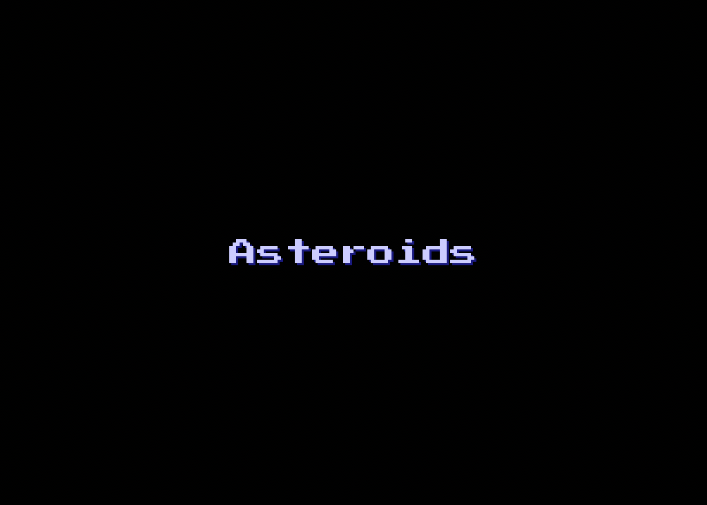
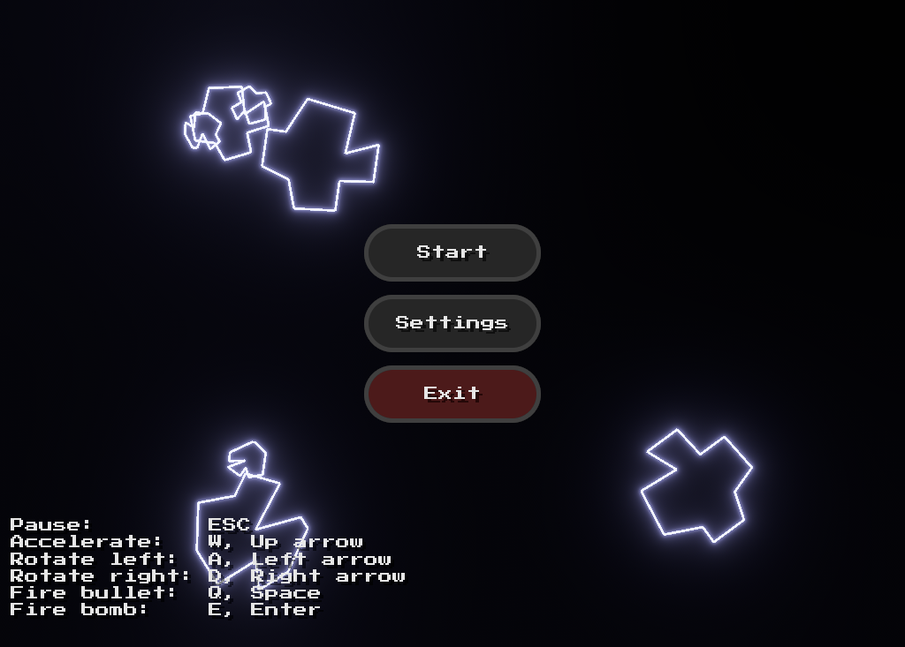
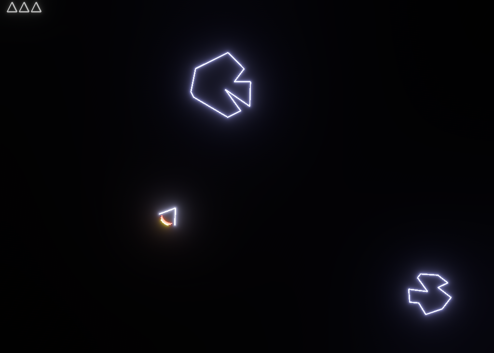
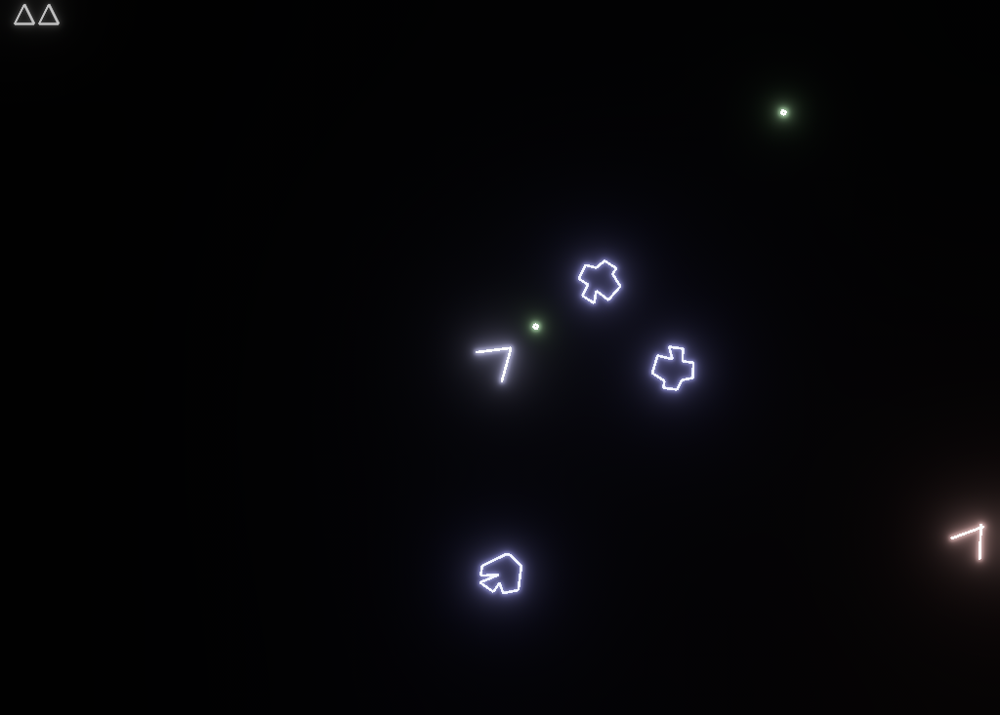
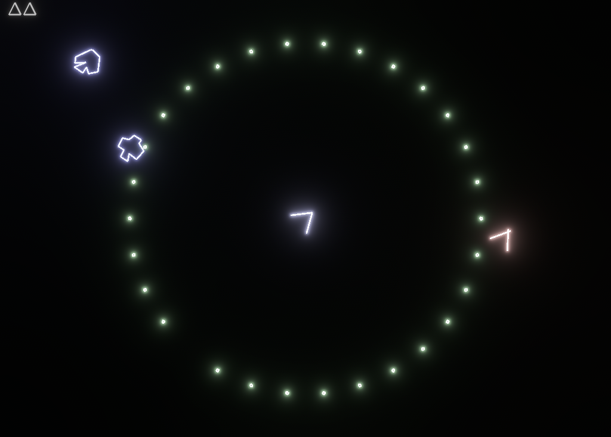
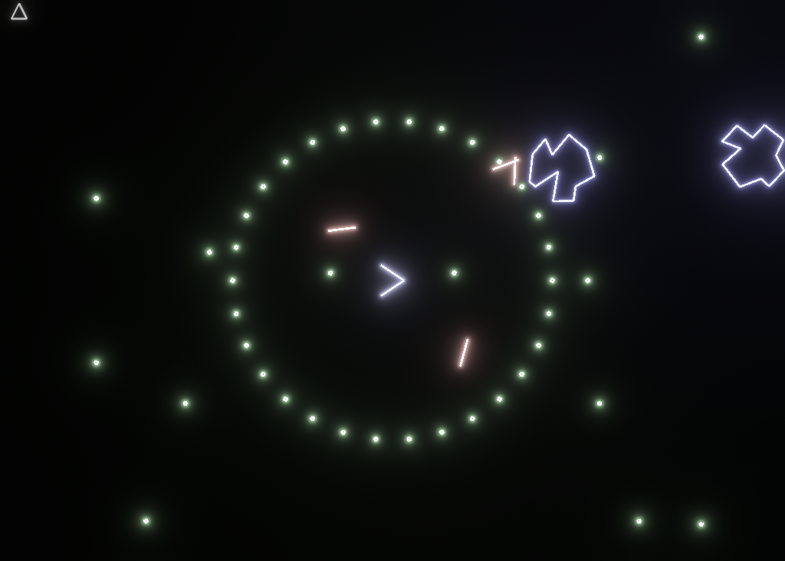
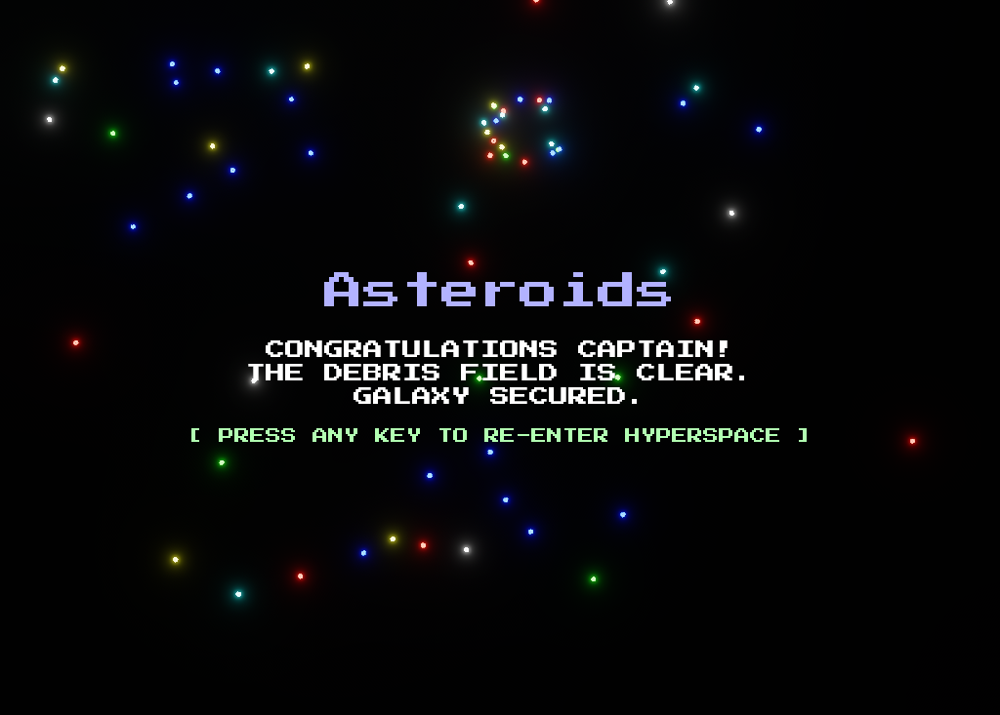

# Asteroids — Rust + Bevy

A classic **Asteroids**-style arcade game written in **Rust** using the **Bevy** game engine.

This project was created as a learning project while exploring game development with Rust and Bevy.

## Features

- Menu navigation
- Emergency bombs
- Sound effects
- Custom gizmo-based graphics
- All assets are compiled into the executable
- Screenshot button
- End game credits

## Play Online

Play the game directly in your browser:

**[Play Asteroids Online](http://games.delarco.com.br/asteroids)**

## Screenshots

| | |
|---|---|
|  |  |
|  |  |
|  |  |
|  |  |

## Controls

| Action | Keyboard |
|---|---|
| Pause | `Esc` |
| Screenshot | `P` |
| Accelerate | `W` / `↑` |
| Rotate Left | `A` / `←` |
| Rotate Right | `D` / `→` |
| Fire Bullet | `Q` / `Space` |
| Fire Bomb | `E` / `Enter` |

## Dependencies

This project is written in Rust and uses the following crates:

- `bevy`
- `rand`
- `getrandom`

See `Cargo.toml` for the complete list of dependencies and their versions.

## Build

### Desktop

Make sure you have Rust and Cargo installed.

Clone the repository and build the project:

```bash
git clone https://github.com/delarco/asteroids-rust
cd asteroids-rust

cargo build --release
```

To run the game directly:

```bash
cargo run --release
```

The compiled executable will be available in:

```text
target/release/
```

### Web

To build the game for the web:

```bash
./build-web.sh
```

The generated web files (`dist` directory) can then be served using a local web server or deployed to a web hosting service.

## Assets

All game assets are compiled directly into the executable.

This means the game does not require external asset files to be present when running the compiled executable.

## TODO

- [ ] Add gamepad support
- [ ] Add background music
- [ ] Add more levels
- [ ] Implement score
- [ ] Add bomb cooldown bar
- [ ] Add tests

## Resources

### Bevy

Resources used to learn and understand Bevy:

- [Bevy Documentation](https://bevyengine.org/learn/)
- [Bevy Examples](https://github.com/bevyengine/bevy/tree/main/examples)
- [Unofficial Bevy Cheat Book](https://bevy-cheatbook.github.io)

### Font

Font `Press Start 2P` were obtained from:

- Google Fonts — https://fonts.google.com/specimen/Press+Start+2P

### Sound Effects

Sound effects were obtained from:

- `Envato` — https://app.envato.com/sound-effects

### Other Resources

- `NiklasEi/bevy_game_template` — https://github.com/NiklasEi/bevy_game_template (web sound fix)

## License

This project is licensed under the **MIT** license.

See the [`LICENSE`](LICENSE) file for details.

---

Made with **Rust** and **Bevy**.